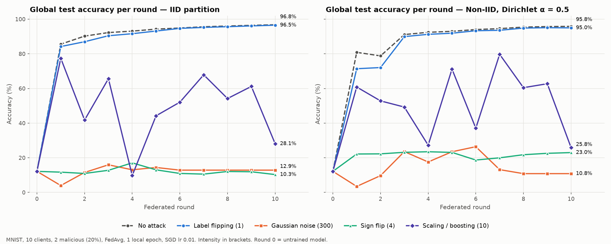
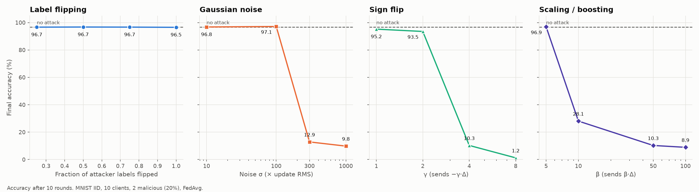
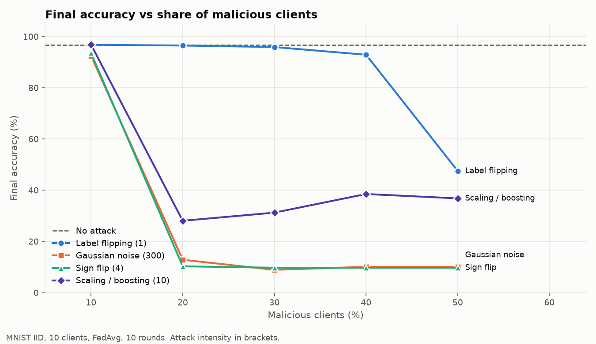
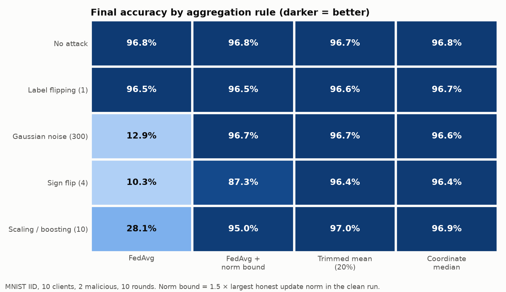
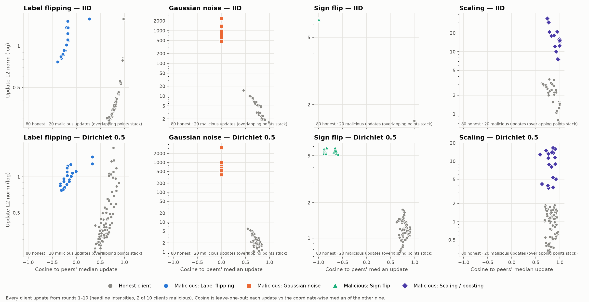
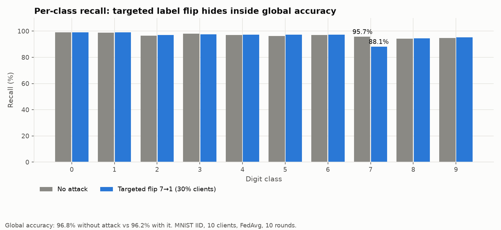

# TRACE-FL Attack Engine: Design, Threat Model, Results

This is the reference for Member 3's attack work: where attacks plug into the FL
loop, what each attack does mathematically, how to run and verify each one, what
the measurements show, and which vulnerabilities were found and fixed.

> **Headline (MNIST, 10 clients, 2 malicious = 20%, FedAvg, 10 rounds):** with no
> attack the global model reaches **96.8%**. Sign flip (γ = 4) drops it to
> **10.3%**, Gaussian noise (σ = 300 × RMS) to **12.9%**, and scaling (β = 10) to
> **28.1%**. Label flipping barely moves it (**96.5%**) until attackers reach 50%
> of clients (**47.5%**). Coordinate median and trimmed mean recover every
> attack to ≥ 96.4%. A static norm bound recovers scaling and noise but **only
> partly sign flip (87.3%)**, because honest updates shrink as training
> converges and the attacker slips under the bound from round 3.

---

## 1. Architecture: where attacks plug in

```text
                         SERVER  (app/server_app.py :: TRACEStrategy)
  ┌───────────────────────────────────────────────────────────────────────────┐
  │ configure_fit   sample clients, remember w_global, send w_global         │
  │      │                                                                    │
  │      ▼                     ...clients train (below)...                    │
  │ aggregate_fit                                                             │
  │   1. decode each FitRes -> NDArrays                                       │
  │   2. UpdateValidator.check   num_examples>0, float32, finite, shapes,     │
  │                              [opt] max_num_examples, [opt] max_update_norm│
  │   3. compute_update_stats    ||Δ||, cosine(Δ, median of peers' Δ)         │
  │      -> `client_update` JSON event per client (measurement only)          │
  │   4. aggregator              fedavg | median | trimmed_mean               │
  │ evaluate        global model on the full 10k test set -> `round_complete` │
  └───────────────────────────────────────────────────────────────────────────┘
                 ▲ (w_client, num_examples, metrics)        │ w_global
                 │                                          ▼
                         CLIENT  (app/client_app.py :: TRACEClient.fit)
  ┌───────────────────────────────────────────────────────────────────────────┐
  │ set_parameters(w_global)                                                  │
  │ AttackEngine.apply_pre_training   ◄── HOOK 1: data poisoning              │
  │      (wraps the DataLoader; label_flipping)                               │
  │ train()  local SGD                                                        │
  │ AttackEngine.apply_post_training  ◄── HOOK 2: model poisoning             │
  │      (rewrites Δ = w_local − w_global; gaussian_noise, sign_flip, scaling)│
  │ return w_sent, num_examples, {loss, accuracy, client_id, is_attacked}     │
  └───────────────────────────────────────────────────────────────────────────┘
```

Design choices:

- **Plug-in, not fork.** Honest and malicious clients run the same `TRACEClient`.
  `AttackEngine.from_config(config)` returns a disabled engine unless
  `attack.enabled: true`, and the two hooks are no-ops for clients outside the
  target set. The FL core has no `if malicious:` branches.
- **Two hook points cover both attack families.** Data poisoning changes *what
  the client learns from*; model poisoning changes *what the client sends*.
- **Non-destructive data poisoning.** `LabelPoisonedDataset` relabels on
  `__getitem__`; the underlying dataset is never mutated, so a client that
  attacks intermittently trains on clean labels in its honest rounds.
- **Deterministic.** Target selection, probabilistic schedules, flip masks and
  noise are all seeded from `config.seed` (plus round and client index), so every
  Ray actor or container makes the same decision with no coordination.
- **Ground truth is logged, never trusted.** The client reports `is_attacked` so
  analysis can label honest vs malicious updates. It is only for evaluation; a
  defense that reads it is cheating.

Module map:

| File | Role |
|---|---|
| `attacks/base.py` | `AttackSchedule` (when/who), `BaseAttack`, `DataPoisoningAttack`, `ModelPoisoningAttack` |
| `attacks/data_poisoning.py` | `LabelPoisonedDataset`, `LabelFlippingAttack` |
| `attacks/model_poisoning.py` | `GaussianNoiseAttack`, `SignFlipAttack`, `ScalingAttack`, `compute_vector_metrics` |
| `attacks/engine.py` | `AttackEngine`: config parsing, dispatch to the two hooks |
| `federation/update_validator.py` | Server-side structural checks + optional caps |
| `federation/update_stats.py` | Per-client norm / cosine signals (same code in server and benchmark) |
| `federation/strategy.py` | `FedAvgStrategy`, `MedianStrategy`, `TrimmedMeanStrategy` |
| `scripts/plot_attack_benchmark.py` | Benchmark harness and every plot below |

## 2. Threat model

| | Assumption (Phase 1) |
|---|---|
| Attacker controls | Its own client entirely: local data, training code, and everything it sends (weights, `num_examples`, metrics, `client_id`) |
| Attacker knows | The current global model (it receives it every round) and its own data |
| Attacker does not know | Other clients' data or updates; the server's defense parameters |
| Number of attackers | `targets.client_ids` or `targets.fraction` of N clients |
| Collusion | Attackers share one config, but do not coordinate updates in a round |
| Adaptivity | None. They do not tune themselves to evade a defense (Phase 6) |
| Server | Honest. Evaluates on a clean central test set |

## 3. The four attacks

Notation: `w_g` is the global model sent this round, `w_l` the attacker's honestly
trained local model, `Δ = w_l − w_g` its honest update, `d` the parameter count
(421,642 for `MNISTNet`), `f` the attackers' share of FedAvg weight (their
share of `num_examples`).

### 3.1 Label flipping (data poisoning)

```text
permutation : y -> 9 − y          (0↔9, 1↔8, …)
targeted    : y == s -> t         (e.g. 7 -> 1), other labels untouched
offset      : y -> (y + 1) mod 10
intensity   = fraction of the attacker's samples relabelled (0..1)
```

The attacker trains normally on wrong labels, so its update is a *legitimate
gradient of the wrong objective* and FedAvg dilutes it by `f`. It is not
invisible: under IID data its updates point away from the honest median
(measured median cosine −0.20 vs +0.82 for honest clients) and are larger
(norm 1.06 vs 0.38), because the model keeps "correcting" itself toward the
wrong labels. Under non-IID data honest clients also drift apart, so the
margin narrows (section 5.5). That overlap is the Phase 1 research question.

### 3.2 Gaussian noise (model poisoning)

```text
Δ' = Δ + N(0, σ² I)      σ = intensity · ||Δ|| / √d     (params.scale_by_norm: true)
```

σ is relative to the update's own per-coordinate RMS, so `intensity = 10`
means the noise vector is ~10x longer than the honest update. Noise is fresh per
(round, client), so attackers' noise partly cancels in the average. The noise is
nearly orthogonal to everything (cosine ≈ 0) and very large (norm ≈ intensity ·
||Δ||).

### 3.3 Sign flip (gradient reversal)

```text
Δ' = −γ · Δ
```

Under IID data all honest updates are roughly the same Δ̄, so FedAvg's step is
`(1 − f) Δ̄ − f γ Δ̄ = (1 − f(1 + γ)) Δ̄`. This gives the critical value

```text
γ* = (1 − f) / f        f = 0.2  ->  γ* = 4
γ < γ*  slower training        γ = γ*  training stalls        γ > γ*  the model is pushed backwards
```

Signature: cosine ≈ −1 to its peers, norm = γ · ||Δ||.

### 3.4 Scaling / boosting

```text
Δ' = β · Δ          (params.boost_factor overrides intensity; β = 1 is a no-op and warns)
```

FedAvg's step becomes `(1 + f(β − 1)) Δ̄`. With `f = 0.2, β = 50` that is a
10.8x larger step, the same as multiplying the learning rate by 10.8. On its
own, boosting an *honest* update is a stability attack (it overshoots). Its real
use in the literature is model replacement: boost a *backdoored* update so it
survives averaging (Bagdasaryan et al., 2020). Backdoors are not in Phase 1.
Signature: cosine ≈ +1 (same direction as honest), norm = β · ||Δ||.

### 3.5 Scheduling and targeting

```yaml
attack:
  schedule:
    mode: continuous | intermittent | custom_rounds | probabilistic
    start_round: 1
    end_round: 20
    interval: 2          # intermittent: active when (round - start_round) % interval == 0
    rounds: [3, 7]       # custom_rounds
    probability: 0.5     # probabilistic, seeded per (round, client)
  targets:
    mode: client_ids | fraction
    client_ids: [0, 3]
    fraction: 0.2        # first round(N * 0.2) client indices (min 1)
```

Intermittent attackers matter for Phase 2 (temporal trust): they look honest in
most rounds.

## 4. How to run and verify each attack

All commands run from `trace-fl/`.

### 4.1 Fast check: one attack vs no attack (~1 min, no Docker)

Runs 5 clients (client 0 malicious) for 3 rounds through the real attack engine,
validator and FedAvg, and prints accuracy per round plus the attacker's
update signature next to the honest clients'.

```bash
uv run python scripts/plot_attack_benchmark.py --demo label_flipping
uv run python scripts/plot_attack_benchmark.py --demo gaussian_noise
uv run python scripts/plot_attack_benchmark.py --demo sign_flip
uv run python scripts/plot_attack_benchmark.py --demo scaling
```

Example (`--demo sign_flip`, γ = 4):

```text
no attack        acc/round:  89.6  93.0  94.8
sign_flip        acc/round:  16.0  12.4   8.8
                 malicious cos=-0.99 norm=8.30 | honest cos=+0.99 norm=2.05
```

### 4.2 End-to-end in the real Flower runtime (Docker)

`run.py` writes the overrides into `experiments/<timestamp>/config.yaml` and
mounts it; `config/config.yaml` is never modified.

```bash
# Label flipping: clients 0 and 1 relabel 100% of their data y -> 9-y
python run.py sim --dataset mnist --partition iid --clients 10 --rounds 10 \
  --attack-type label_flipping --attack-intensity 1.0 --attack-mode continuous --attack-start 1 --attack-clients 0,1

# Gaussian noise: noise 30x the update's RMS
python run.py sim --dataset mnist --partition iid --clients 10 --rounds 10 \
  --attack-type gaussian_noise --attack-intensity 30 --attack-mode continuous --attack-start 1 --attack-clients 0,1

# Sign flip: send -4 x delta (gamma = 4 is the stall point for 20% attackers)
python run.py sim --dataset mnist --partition iid --clients 10 --rounds 10 \
  --attack-type sign_flip --attack-intensity 4 --attack-mode continuous --attack-start 1 --attack-clients 0,1

# Scaling: send 50 x delta
python run.py sim --dataset mnist --partition iid --clients 10 --rounds 10 \
  --attack-type scaling --attack-intensity 50 --attack-mode continuous --attack-start 1 --attack-clients 0,1

# Same attack against a robust aggregator, or with norm bounding on
python run.py sim ... --aggregation median
python run.py sim ... --max-update-norm 6

# Intermittent attacker (every 2nd round from round 2), 20% of clients
python run.py sim --attack-type sign_flip --attack-intensity 4 --attack-mode intermittent \
  --attack-start 2 --attack-interval 2 --attack-clients 0.2
```

`--attack-clients` takes a list (`0,1`) or a fraction (`0.2` means the first 20%
of client indices).

### 4.3 What to look for in the logs

Three structured JSON events tell the whole story:

| Event | Emitted by | Shows |
|---|---|---|
| `attack_injected` | attacker client | attack type, round, and for model poisoning `l2_norm_honest`, `l2_norm_poisoned`, `cosine_similarity` (poisoned vs its own honest Δ) |
| `client_update` | server, every client, every round | `update_norm`, `cosine_to_peers`, `accepted`, `rejection_reason`, and `is_attacked` (ground truth) |
| `round_complete` | server | `global_accuracy`, `global_loss`, `macro_f1`, `roc_auc`, bytes |

```bash
python run.py sim --attack-type sign_flip ... 2>&1 | tee run.log   # simulation logs go to the terminal only
LOG=run.log
grep -o '{"event": "round_complete".*' $LOG | python -c "import sys,json;[print(e['round'],round(e['global_accuracy']*100,2)) for e in map(json.loads,sys.stdin)]"
grep '"is_attacked": true' $LOG | grep client_update
```

Real output from `python run.py sim --dataset mnist --partition iid --clients 5 --rounds 3 --attack-type sign_flip --attack-intensity 4 --attack-mode continuous --attack-start 1 --attack-clients 0`:

```text
round_complete  round 0  global_accuracy 0.1244
client_update   client_0  is_attacked true   update_norm 8.29  cosine_to_peers -0.989
client_update   client_1  is_attacked false  update_norm 2.04  cosine_to_peers +0.987
round_complete  round 1  global_accuracy 0.1123
round_complete  round 2  global_accuracy 0.0800
round_complete  round 3  global_accuracy 0.0676      # stuck at chance: γ = γ* = 4 for f = 0.2
```

### 4.4 Full benchmark (all graphs below)

```bash
uv run python scripts/plot_attack_benchmark.py --rerun          # all suites
uv run python scripts/plot_attack_benchmark.py --suite fraction --rerun
uv run python scripts/plot_attack_benchmark.py --plot-only      # redraw from the cached JSON
```

Cost: about 11 s per round on this CPU (one round = one epoch over all 60k
training images plus a 10k-image evaluation). The CPU is power-throttled, so
adding worker processes barely helps (measured: 0.7 to 0.95 client-epochs/s
total). The script uses CUDA if the interpreter's torch has it; the project
lockfile is CPU-only.

## 5. Results

Setup unless stated: MNIST, IID, 10 clients, attackers are clients 0 and 1
(20%), attack active every round, FedAvg, 1 local epoch, SGD lr 0.01, batch 32,
10 rounds, seed 42. "Headline" intensities are the smallest swept values that
clearly hurt FedAvg: label flip 1.0, Gaussian 300, sign flip 4, scaling 10.
Every number below is in `artifacts/benchmarks/attack_benchmark_results.json`
(62 experiments).

### 5.1 Accuracy per round



| Attack (headline) | IID final | Drop | Dirichlet α=0.5 final | Drop |
|---|---|---|---|---|
| No attack | 96.78% | — | 95.84% | — |
| Label flipping (1.0) | 96.52% | −0.3 | 94.97% | −0.9 |
| Gaussian noise (300) | 12.86% | −83.9 | 10.84% | −85.0 |
| Sign flip (4) | 10.30% | −86.5 | 22.99% | −72.9 |
| Scaling (10) | 28.08% | −68.7 | 25.84% | −70.0 |

How to read it:
- **Sign flip and Gaussian** pin the model at chance (~10%) from round 1.
- **Scaling** zig-zags between 10% and 78%: a 2.8x effective learning rate
  overshoots, then partly recovers. Its "final accuracy" is a snapshot of an
  oscillation, so treat ±10 pp as noise for this attack.
- **Sign flip under non-IID (23% vs 10%)**: not a data-share effect (attackers
  hold 20.4% vs 20.0% of the data). The `(1 − f(1+γ))` formula assumes every
  update points the same way. Under non-IID the attackers flip *their own*
  update, which is not parallel to the consensus, so the cancellation is
  incomplete.

### 5.2 Intensity: where each attack starts to bite



| Attack | Final accuracy by intensity |
|---|---|
| Label flipping (fraction flipped) | 0.25: 96.65 · 0.5: 96.74 · 0.75: 96.67 · 1.0: 96.52 |
| Gaussian σ (× RMS) | 10: 96.78 · 100: 97.12 · **300: 12.86** · 1000: 9.80 |
| Sign flip γ | 1: 95.20 · 2: 93.50 · **4: 10.30** · 8: **1.23** |
| Scaling β | 5: 96.85 · **10: 28.08** · 50: 10.28 · 100: 8.92 |

- **Sign flip matches theory exactly.** The predicted stall point is
  γ* = (1 − f)/f = 4 for f = 0.2. At γ = 8 accuracy is 1.2%, *below* chance:
  the model has learned to avoid the right answer.
- **Gaussian noise is a cliff, not a slope.** Up to 100× the update's size it
  is harmless: 421,642-dimensional random noise is almost orthogonal to the
  loss gradient and averages out. Between 100× and 300× it crosses over and
  destroys the model.
- **Label flipping at 20% does nothing measurable.** The spread from 96.5 to
  96.7 is within seed noise. Eight honest clients outvote two.

### 5.3 How many attackers does it take?



| Malicious clients | 10% | 20% | 30% | 40% | 50% |
|---|---|---|---|---|---|
| Label flipping (1.0) | 96.82 | 96.52 | 95.93 | 92.92 | **47.52** |
| Gaussian noise (300) | 92.50 | 12.86 | 8.92 | 10.10 | 10.10 |
| Sign flip (4) | 93.56 | 10.30 | 9.74 | 9.74 | 9.74 |
| Scaling (10) | 96.89 | 28.08 | 31.26 | 38.53 | 36.82 |

FedAvg tolerates one attacker in ten for every attack, but not two for the
model-poisoning attacks. Label flipping only breaks at 50%. There, 46% of
test images are predicted as exactly `9 − y`: the model has learned the
attacker's relabelling.

### 5.4 Defenses



| Attack | FedAvg | FedAvg + norm bound | Trimmed mean (20%) | Coord. median |
|---|---|---|---|---|
| No attack | 96.78 | 96.78 | 96.73 | 96.75 |
| Label flipping | 96.52 | 96.52 | 96.63 | 96.66 |
| Gaussian noise | 12.86 | 96.67 | 96.68 | 96.63 |
| Sign flip | 10.30 | **87.30** | 96.35 | 96.42 |
| Scaling | 28.08 | 95.02 | 97.01 | 96.90 |

**Why norm bounding only partly stops sign flip.** The bound is fixed at
1.5 × the largest honest norm in a clean run (2.38). Honest update norms shrink
from 1.59 in round 1 to 0.23 in round 10. From round 3 the attacker's update
(4 × 0.44 = 1.76) is under the bound and is accepted every round, and
accuracy erodes from 89% to 79% before ending at 87%. Scaling slips through in
rounds 9 and 10 for the same reason. A static threshold decays as training
converges, and an adaptive attacker would simply scale to just under it from
round 1. This argues for *relative* signals (vs peers, vs history), which is
what temporal trust (Phase 2) is meant to do.

Median and trimmed mean win here because attackers are 20% and the data is
IID. They have known costs this experiment does not show: they discard
honest information under strong non-IID, and they break above 50% attackers
(trimmed mean above its trim ratio).

### 5.5 Do malicious updates look different? (Phase 1 research question)



Median over all rounds, IID:

| Attack | Malicious cosine | Honest cosine | Malicious norm | Honest norm | Separable by |
|---|---|---|---|---|---|
| Label flipping | −0.20 | +0.82 | 1.06 | 0.38 | cosine (and norm) |
| Gaussian noise | +0.01 | +0.95 | 1880 | 5.65 | both, trivially |
| Sign flip | −0.99 | +0.99 | 6.38 | 1.59 | cosine |
| Scaling | +0.97 | +0.97 | 14.65 | 1.46 | **norm only** |

- **Scaling is invisible to cosine.** It points the same way as honest updates,
  so a cosine-only detector misses it, and norm is required.
- **Non-IID blurs the picture (bottom row).** Honest clients spread from cosine
  0.4 to 0.9 and their norms overlap the label-flippers' range. Label flipping
  is still separable by cosine at α = 0.5, but the margin is much narrower
  than under IID. This is where representation-level signals (CKA) need to
  prove their worth, and the experiment to run next at α = 0.1.
- Cosine is computed against the **leave-one-out coordinate median** of peers.
  A mean reference was tried first and was dragged by the attacker: with one
  sign-flipper sending −4Δ, *honest* clients scored cosine −0.87.

### 5.6 Targeted label flipping hides inside global accuracy



Three attackers (30%) relabel only digit 7 as 1. Global accuracy goes from
96.78% to 96.23% (−0.55 pp, easy to dismiss as noise), while **class-7
recall drops from 95.7% to 88.1%**. Global accuracy is the wrong metric for
targeted attacks; report per-class recall (logged in `eval_metrics.json` as
`class_recall`).


## 6. Vulnerabilities found and what was done

Found while reviewing the attack integration. "Fixed" means code plus a
regression test in `tests/test_hardening.py`.

### 6.1 Bugs that broke or silently corrupted experiments

| # | Problem | Impact | Status |
|---|---|---|---|
| B1 | `telemetry/logging.py` used `Optional` without importing it | **Every** Flower run crashed at import; the tests never imported the app, so CI stayed green | Fixed, plus an import smoke test for `app.server_app` / `app.client_app` |
| B2 | `scripts/plot_attack_benchmark.py` drew the "cosine similarity" panel from hard-coded numbers (`[0.85, 0.42, 0.05, -1.0, 1.0]`) | `attack_vector_signatures.png` looked like a measurement but wasn't | Rewritten: every plotted number is measured |
| B3 | `AttackSchedule` mapped any unparseable client id to index 0 | An opaque id (e.g. a Ray `cid`) was treated as the default attacker | Fixed: unparseable means never targeted |
| B4 | `targets.mode` was ignored; `client_ids` always won | `run.py sim --attack-clients 0.2` kept attacking only client 0 (config still had `client_ids: [0]`) | Fixed: `targets.mode` selects |
| B5 | `run.py` without PyYAML on the host dropped all `--attack-*` flags | An "attack run" was actually honest, with no warning | Fixed: exits with an error |
| B6 | Gaussian noise used the same RNG seed for every attacker in a round | All attackers sent the identical noise vector, so it never averaged out (unintended collusion) | Fixed: seed includes the client index |
| B7 | `interval: 0` gave a ZeroDivisionError inside a Ray actor; unknown schedule or label-flip modes fell back silently; `targeted` without source/target flipped nothing | Crashes mid-run, or attacks that silently did nothing | Fixed: validated at config load |
| B8 | `client_fn` read `config/config.yaml` relative to the CWD and fell back to `node_id % N` for the partition | Wrong or missing config in deployment; two clients could share one partition | Fixed: `load_config()`; refuse to start without `partition-id` |
| B9 | `scaling` with the config's default `intensity: 1.0` | A no-op "attack" | Warns |
| B10 | `run.py deploy` ignored every flag | Could not run an attack in deployment mode | Fixed |
| B11 | Label flipping created a `torch.Generator` per sample; confusion matrix was a Python loop over 10k samples | Slow | Vectorised |

### 6.2 Security vulnerabilities in the FL protocol

| # | Vulnerability | Exploit | Status |
|---|---|---|---|
| V1 | **Self-reported `num_examples`** sets each client's FedAvg weight | One client claims 10⁹ samples and effectively *becomes* the global model (model replacement with no scaling) | Mitigated: `federation.max_num_examples` rejects claims above a cap; `median`/`trimmed_mean` ignore weights |
| V2 | **No magnitude bound** on updates | Scaling and large-noise attacks pass every check | Mitigated: optional `federation.max_update_norm` (norm bounding). Evadable: an attacker who stays under the bound still gets through (see 5.4) |
| V3 | **FedAvg has breakdown point 0** | One attacker suffices (all four attacks) | Mitigated: `federation.aggregation: median | trimmed_mean`. Krum is Member 4's |
| V4 | **dtype not validated** | An int64 array of the right shape as the first update made FedAvg's in-place float add raise, crashing the round (one-packet DoS) | Fixed: updates must be float32 |
| V5 | `client_id` and `is_attacked` are self-reported | A client can impersonate another in the logs; `is_attacked` is trivially falsifiable | Documented. Analysis-only fields; real identity needs Phase 3 (PKI / node auth) |
| V6 | Deployment uses gRPC `--insecure` | No TLS and no node authentication: a man-in-the-middle can rewrite updates | Documented. Out of Phase 1 scope (PKI is listed as Phase 3) |
| V7 | Every simulated client loads the full dataset into its process | In simulation a "client" could read other partitions; isolation is logical only | Documented in `docs/member1_architecture_security_audit.md` |
| — | Pickle deserialization of updates | Checked: Flower decodes with `np.load(..., allow_pickle=False)`, so no RCE path | Not vulnerable |

## 7. Known limitations and things deliberately not built

- **Krum / Multi-Krum, FLTrust, CKA**: not implemented (Member 4). `update_stats`
  provides norm and cosine only.
- **Backdoor attacks** (trigger patterns, model replacement): not in Phase 1.
  Scaling is therefore shown as a stability attack, not a backdoor carrier.
- **Adaptive attackers** (stay under the norm bound, mimic honest cosine):
  Phase 6. Every defense result here is against a *non-adaptive* attacker and
  is optimistic.
- **Fraction targeting is "first k indices".** Under Dirichlet partitions
  attackers' data share (their FedAvg weight) depends on which indices they
  are, so results vary with the seed. The benchmark records
  `malicious_data_share` for each run.
- **The benchmark bypasses Flower transport** (it calls the same components
  in-process). Verified against the real Flower runtime for sign flip (4.3);
  numbers match the theory.
- **Results are from a single seed (42).** Differences under about 0.3
  percentage points (e.g. label flipping vs no attack at 20%) are within seed
  noise. Run more seeds before claiming anything finer.
- **GPU vs CPU**: CUDA kernels are not bit-deterministic; the same experiment
  can differ by about 0.1 pp between devices. All published numbers come from
  one device (GPU).
- The interactive `run.py` menu does not prompt for attack settings; use the
  `run.py sim --attack-*` flags.
- `artifacts/eval_results/eval_metrics.json` is written relative to the
  server's working directory; inside Docker it is not on a mounted volume.

## 8. Docker in one paragraph

`Dockerfile` builds a pinned image (Python 3.11.14, `uv sync --frozen` from
`uv.lock`, MNIST and Fashion-MNIST baked in, CPU torch). **Simulation mode**
(`python run.py sim`) runs one container where `flwr run` starts a local
SuperLink and Ray schedules N virtual ClientApps. `shm_size: 3gb` is set for
Ray's object store, and the per-run config is bind-mounted read-only from
`experiments/<timestamp>/config.yaml`. **Deployment mode**
(`python run.py deploy`) generates a compose file with one `superlink`
container (the ServerApp), N `supernode-i` containers (each a real client
process with `partition-id=i`), and a `cli` container that submits the run over
gRPC. Use it to run an attacker as its own process or to kill a client
mid-run. Details are in `DOCKER.md`.

